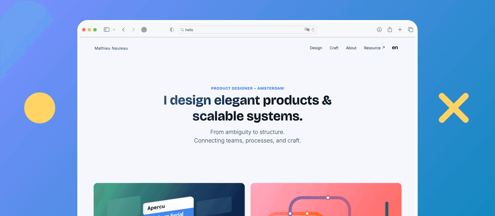

### Styleguide
https://mathieunauleau.com/styleguide.html

### Design tokens
Tokens come from the [`@mathieu.nauleau/tokens`](https://www.npmjs.com/package/@mathieu.nauleau/tokens) npm package and are copied into `tokens.css`. Don't edit `tokens.css` by hand.
- Sync: `npm install` (or `npm run sync-tokens`)
- Update: change the version in `package.json`, run `npm install`, then commit `tokens.css` and `package-lock.json`

### Localization
- [🔗 Google doc with en/fr and json script](https://docs.google.com/spreadsheets/d/1DXCQv8tG4r3myD3zPm-TXPQ0g9M5Fl6IZgSfNKU26AY/edit?usp=sharing)
- [🔗 POEditor](https://poeditor.com/)

### Favorite resources
[🔗 Emojicom feedback](https://emojicom.io)

### License
[🔗 Based on the Flexstart Bootstrap startup template](https://bootstrapmade.com/flexstart-bootstrap-startup-template/)